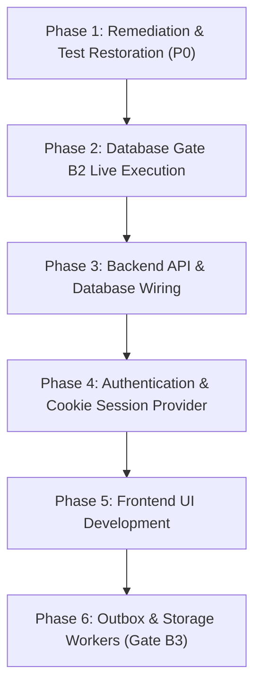

# Parul University Intellectual Property Rights (IPR) Portal
# Comprehensive Technical Audit Report

**Audit Execution Date:** November 25, 2026  
**Auditor:** Automated Codebase & Security Inspection Engine  
**Target Repository:** Parul University IPR Portal Monorepo (`@ipr/shared`, `@ipr/backend`, `@ipr/frontend`)  
**Audit Scope:** End-to-end repository architecture, database migrations, authentication, authorization, frontend/BFF forwarding, backend services, IPR business workflows, and automated verification suites.

---

## 1. Executive Summary

This report delivers a thorough, end-to-end technical inspection of the Parul University IPR Portal repository in a single execution pass. The audit was conducted strictly in a read-only manner: no application source code, database migrations, configuration files, or package dependencies were altered. No secrets, credentials, or `.env` contents are printed or exposed.

### Core Audit Takeaways:
1. **Foundation & Cryptographic Security are Strong:** The cryptographic specifications (BFF assertion HMAC signing, RFC 7807 problem details, CSRF token generation, and the Provisonal Invention Disclosure Canonical Schema) implemented in `@ipr/shared` are mature, well-tested (64/64 tests passing), and conform to institutional security specifications.
2. **Critical Migration Integrity Defect:** Migration `006_grants_privileges.sql` was accidentally wiped and reduced to a single-line comment (`-- Application-role credentials are configured outside database migrations.`). This completely disables database least-privilege enforcement, revokes nothing from runtime roles, and grants nothing to `ipr_definer`, `ipr_scanner`, or `ipr_worker`.
3. **Backend is a Mock Skeleton:** While `packages/backend` defines an Express app with helmet, cors, and BFF verification middleware, **no database queries are executed**. The backend exposes only two mock endpoints (`POST /api/v1/drafts/:id/submit` and `GET /api/v1/disclosures/:id`) which return static mock payloads. The initialized `pg.Pool` in `server.ts` is never passed to `createApp(env)`, leaving all database gateways disconnected from HTTP routes.
4. **Authentication is Missing at the Application Layer:** A new migration (`007_authentication.sql`) provides SQL routines for student self-registration and session storage, but **zero backend controllers or routes exist to expose them**.
5. **Frontend UI is 0% Implemented:** `packages/frontend/src/app/page.tsx` contains only placeholder text. There are no pages, forms, or navigation components for student registration, login, disclosure submission, inventor consent, reviewer evaluation, legal clearance, or administrative governance. Furthermore, the Next.js BFF route handler hardcodes a test mock session provider and fallback secrets.
6. **Test Suite Regressions:** Running `pnpm run test` fails with 5 test failures in `@ipr/backend` (3 in `env.spec.ts` due to missing mock SMTP credentials, 2 in `migrations.spec.ts` due to `007_authentication.sql` presence and the wiped `006_grants_privileges.sql`).

---

## 2. Overall Completion Percentage

### Completion Score: **34.5%**

The completion percentage is computed using an objective weighted matrix across the five distinct layers required for a functioning production web application:

$$\text{Overall Completion} = \sum (\text{Layer Weight} \times \text{Layer Completion})$$

| System Layer | Weight | Completion | Weighted Score | Justification |
| :--- | :---: | :---: | :---: | :--- |
| **1. Shared Core & Security Contracts (`@ipr/shared`)** | 20% | **90%** | **18.0%** | PIDCS validation, HMAC canonicalization, CSRF token utilities, operation scopes, DTOs, and resource-auth interfaces are complete and 100% tested (64 passing unit tests). Minor: Live Redis adapter missing. |
| **2. Database Migrations & Schemas (`packages/backend/migrations`)** | 25% | **65%** | **16.25%** | Migrations 001–005 and 007 contain robust SQL definitions and gateways. However, 006 is wiped/empty, 007 is untracked by tests, and zero migrations have been run or tested against a real PostgreSQL instance. |
| **3. Backend API & Business Services (`@ipr/backend`)** | 25% | **20%** | **5.0%** | Express app, security middleware, and email service class exist. However, 0 database queries run in HTTP endpoints, 12 of 14 routes are 404s, no auth routes exist, and the DB pool is disconnected from `app.ts`. |
| **4. Frontend Client & BFF Layer (`@ipr/frontend`)** | 20% | **15%** | **3.0%** | BFF forwarder and CSRF client exist and pass tests. However, UI pages are 0% implemented (only placeholder `<h1>`), mock session provider is hardcoded in production routes, and fallback secrets are used. |
| **5. External Integrations & Infrastructure Verification** | 10% | **10%** | **1.0%** | Email service client is written but not wired to registration. PostgreSQL, ClamAV, Redis, and S3 have never been connected or verified live. |
| **Total** | **100%** | | **34.5%** | **Overall Repository Maturity** |

---

## 3. Working Features

The following capabilities are implemented, verified by unit/integration tests, and structurally sound:

1. **Cryptographic Inter-Service Assertion Signing:**
   - Canonical assertion construction ([hmac-canonical.ts](file:///d:/GitHub/IPR-Parul%20University/packages/shared/src/security/hmac-canonical.ts#L32)).
   - HMAC-SHA256 signature generation and verification.
   - Nonce generation and in-memory replay prevention ([in-memory-nonce-store.ts](file:///d:/GitHub/IPR-Parul%20University/packages/shared/src/security/in-memory-nonce-store.ts#L8)).
   - Clock skew drift rejection ($\pm 300\text{s}$).
   - Request body SHA-256 integrity binding.
2. **CSRF Protection Architecture:**
   - Cryptographic CSRF token generation and signature verification ([csrf.ts](file:///d:/GitHub/IPR-Parul%20University/packages/shared/src/security/csrf.ts#L22)).
   - Time-limited token expiry (1 hour).
   - Constant-time HMAC comparison preventing timing attacks.
3. **PIDCS Data Validation Schema:**
   - Comprehensive Zod validation for Provisional Invention Disclosure Canonical Schema ([provisional-pidcs.schema.ts](file:///d:/GitHub/IPR-Parul%20University/packages/shared/src/contracts/provisional-pidcs.schema.ts#L20)).
   - Enforces 10,000 basis points total inventor share distribution.
   - Rejects missing abstracts, invalid basis point totals, or malformed inventor arrays.
4. **Operation Scope & Role Registry:**
   - 14 dedicated operation scopes defined in [operation-scopes.constants.ts](file:///d:/GitHub/IPR-Parul%20University/packages/shared/src/contracts/operation-scopes.constants.ts#L29).
   - Strict least-privilege role matrix enforcing separation between Student, Faculty, Reviewer, Legal, and Administrator.
5. **Backend Security Middleware:**
   - RFC 7807 standard problem details formatting ([error-handler.middleware.ts](file:///d:/GitHub/IPR-Parul%20University/packages/backend/src/middleware/error-handler.middleware.ts#L25)).
   - Request-ID tracing ([request-id.middleware.ts](file:///d:/GitHub/IPR-Parul%20University/packages/backend/src/middleware/request-id.middleware.ts#L7)).
   - Centralized BFF assertion authentication middleware ([bff-assertion.middleware.ts](file:///d:/GitHub/IPR-Parul%20University/packages/backend/src/middleware/bff-assertion.middleware.ts#L23)).
   - Typed object-level resource authorization middleware ([resource-authorization.middleware.ts](file:///d:/GitHub/IPR-Parul%20University/packages/backend/src/middleware/resource-authorization.middleware.ts#L18)).
6. **Frontend BFF Forwarder Logic:**
   - Whitelist enforcement preventing open-proxy relaying ([bff-forwarder.ts](file:///d:/GitHub/IPR-Parul%20University/packages/frontend/src/server/bff-client/bff-forwarder.ts#L30)).
   - Header strip/sanitization before forwarding to backend.

---

## 4. Partially Implemented Features

1. **Student Self-Registration & Email Verification:**
   - *Implemented:* `007_authentication.sql` defines `auth_internal.pending_registrations` with domain check `@paruluniversity.ac.in`, Argon2id hash checks, and verification token expiry. `EmailService` class exists with nodemailer.
   - *Missing:* Backend HTTP controller for registration/verification, token email dispatch logic, frontend registration page, and verification completion UI.
2. **Invention Disclosure Creation & Submission:**
   - *Implemented:* Stored procedures `create_draft_disclosure_v1`, `update_draft_disclosure_v1`, and `submit_initial_disclosure_v3` in `005_institutional_gateways.sql`. PIDCS validation schema in shared.
   - *Missing:* Backend API endpoints calling these SQL routines via database pool; frontend form components for drafting and submitting disclosures.
3. **Monthly Tracking Number Generation (`IPR-YYYYMMNNN-XXX`):**
   - *Implemented:* Transactional counter row locking (`FOR UPDATE`) with atomic sequential increment in `submit_initial_disclosure_v3`.
   - *Missing:* Live database verification under high concurrency.
4. **Inventor Consent Management:**
   - *Implemented:* SQL gateways for consent creation, verification, and revocation (`create_inventor_consent_request_v1`, `verify_inventor_consent_v1`, `revoke_inventor_consent_v1`).
   - *Missing:* Backend routes, email notification triggers, and signature upload frontend UI.
5. **Patent Application Docketing & Lifecycle Transitions:**
   - *Implemented:* SQL gateways `create_patent_application_v1`, `assign_patent_legal_officer_v1`, and `record_patent_stage_transition_v2`. Enforces legal clearance pre-condition and dual Legal/Admin authority.
   - *Missing:* Backend routes and frontend patent docket management screens.
6. **Database Connection Pooling:**
   - *Implemented:* `packages/backend/src/db/pool.ts` instantiates a `pg.Pool` with SSL configuration and timeouts.
   - *Missing:* Pool instance is instantiated in `server.ts` but never injected into `app.ts` routes.

---

## 5. Missing Features

1. **User Interface (Entire Frontend):**
   - No Login screen.
   - No Registration screen.
   - No Email verification landing page.
   - No Inventor Dashboard (viewing disclosures, consent statuses, attachments).
   - No Disclosure drafting/submission wizard (PIDCS form).
   - No Admin Reviewer assignment panel.
   - No Reviewer evaluation rubric submission form.
   - No Legal Officer clearance and patent docketing portal.
2. **Backend Authentication & Session Controller:**
   - No `POST /api/v1/auth/register` endpoint.
   - No `POST /api/v1/auth/verify` endpoint.
   - No `POST /api/v1/auth/login` endpoint.
   - No `POST /api/v1/auth/logout` endpoint.
   - No `GET /api/v1/auth/me` or session introspection endpoint.
3. **Faculty Account Administrative Provisioning:**
   - Requirement specifies: *"Faculty accounts provisioned by Admin"*.
   - No SQL stored procedure exists in `007_authentication.sql` for an Administrator to provision a Faculty account with initial credentials or invitation token.
4. **Reviewer Evaluation Stored Procedure:**
   - Requirement specifies: *"Reviewer evaluation"*.
   - Scope `OP_REVIEW_EVALUATION` exists in shared constants, but **no SQL gateway function** (e.g. `record_reviewer_evaluation_v1`) exists in `005_institutional_gateways.sql` to record scores, recommendation, and comments in the database.
5. **Live Cookie-Based Session Provider in BFF:**
   - The BFF route handler relies exclusively on `MockTestSessionProvider`. There is no implementation of an `HttpOnlyCookieSessionProvider` that reads session cookies from the incoming browser request, validates them via backend/database, and extracts authenticated actor context.
6. **Outbox Event Processor / Background Worker Daemon:**
   - Migrations define `outbox_messages`, `outbox_tasks`, and worker gateway routines (`claim_outbox_tasks_v1`, etc.).
   - No executable background worker process exists in `packages/backend` to poll outbox tasks, process email dispatches, or manage antivirus scanning queues.

---

## 6. Issues by Severity

### Critical Severity (P0)

#### [P0-1] Migration `006_grants_privileges.sql` Accidental Truncation / Empty File
- **File:** [packages/backend/migrations/006_grants_privileges.sql](file:///d:/GitHub/IPR-Parul%20University/packages/backend/migrations/006_grants_privileges.sql#L1) (Line 1)
- **Evidence:** The entire file consists of one line:
  ```sql
  -- Application-role credentials are configured outside database migrations.
  ```
- **Practical Impact:**
  - Table DML privileges (`SELECT`, `INSERT`, `UPDATE`, `DELETE`) are NOT revoked from runtime connection roles (`ipr_app`, `ipr_scanner`, `ipr_worker`), violating defense-in-depth.
  - The security definer owner `ipr_definer` is NOT granted table access to foundational tables (`disclosures`, `attachments`, `inventor_consents`, etc.) or execution rights on `pgcrypto` functions (`digest`, `hmac`, `gen_random_uuid`).
  - Read gateways (`get_disclosure_v1`, `get_patent_application_v1`, `get_attachment_metadata_v1`) are NOT granted to `ipr_app`.
  - Background worker routines are NOT granted to `ipr_worker`.
  - Database migrations will fail static tests and cannot produce an operable, secure schema.
- **Recommended Correction:** Restore the complete content of `006_grants_privileges.sql` containing dynamic database revocations, explicit table DML revocations from runtime roles, explicit table grants to `ipr_definer`, sequence grants, `pgcrypto` execution grants, scanner gateway grants to `ipr_scanner`, worker grants to `ipr_worker`, and read gateway grants to `ipr_app`.

#### [P0-2] Production BFF Route Uses Hardcoded Fallback Secrets and Test Session Provider
- **File:** [packages/frontend/src/app/api/bff/[...path]/route.ts](file:///d:/GitHub/IPR-Parul%20University/packages/frontend/src/app/api/bff/%5B...path%5D/route.ts#L7-L10) (Lines 7–10)
- **Evidence:**
  ```typescript
  const sharedSecretHex = process.env.BFF_SHARED_SECRET || '0123456789abcdef0123456789abcdef0123456789abcdef0123456789abcdef';
  const csrfSecret = process.env.CSRF_SECRET || 'parul_university_ipr_bff_csrf_secret_production_seed_12345';
  const sessionProvider = new MockTestSessionProvider();
  ```
- **Practical Impact:**
  - If `BFF_SHARED_SECRET` or `CSRF_SECRET` is unset, the system silently falls back to known, publicly visible secret strings, enabling trivial signature forgery.
  - Using `MockTestSessionProvider` in production means anyone can pass `x-test-session-user: <uuid>` and `x-test-session-roles: Administrator` in HTTP headers to impersonate any user or administrator without authentication.
- **Recommended Correction:**
  - Require `BFF_SHARED_SECRET` and `CSRF_SECRET` at initialization and throw a fatal startup error if unset.
  - Replace `MockTestSessionProvider` with an authentic `HttpOnlyCookieSessionProvider` that decrypts/validates genuine session tokens against `auth_internal.user_sessions`.

#### [P0-3] Database Connection Pool Never Injected into Express HTTP Handlers
- **File:** [packages/backend/src/server.ts](file:///d:/GitHub/IPR-Parul%20University/packages/backend/src/server.ts#L15-L20) (Lines 15–20) & [packages/backend/src/app.ts](file:///d:/GitHub/IPR-Parul%20University/packages/backend/src/app.ts#L21) (Line 21)
- **Evidence:** In `server.ts`:
  ```typescript
  pool = createDatabasePool(env);
  await pool.query('SELECT 1');
  const app = createApp(env); // pool is never passed into createApp!
  ```
  And in `app.ts`:
  ```typescript
  export interface CreateAppOptions {
    readonly nonceStore?: INonceStore;
    readonly allowedClockSkewSeconds?: number;
    readonly resourceAuthProvider?: IResourceAuthorizationProvider;
  }
  ```
- **Practical Impact:** Even when PostgreSQL is connected, the Express application has no handle to the database pool. Zero HTTP requests can execute SQL queries or institutional gateways.
- **Recommended Correction:** Add `dbPool: pg.Pool` to `CreateAppOptions` in `app.ts`, pass `pool` from `server.ts`, and attach controllers that call database stored procedures with request assertion JSON payloads.

---

### High Severity (P1)

#### [P1-1] 12 Whitelisted BFF Endpoints Route to 404 Handlers on the Backend
- **File:** [packages/frontend/src/server/bff-client/bff-forwarder.ts](file:///d:/GitHub/IPR-Parul%20University/packages/frontend/src/server/bff-client/bff-forwarder.ts#L44-L114) (Lines 44–114) & [packages/backend/src/app.ts](file:///d:/GitHub/IPR-Parul%20University/packages/backend/src/app.ts#L125-L161) (Lines 125–161)
- **Evidence:** The BFF whitelist maps `/drafts`, `/attachments`, `/consent/request`, `/consent/verify`, `/consent/revoke`, `/disclosures/:id/assign-reviewer`, `/disclosures/:id/evaluate`, `/disclosures/:id/legal-clearance`, `/patents`, `/patents/:id/assign-legal`, and `/patents/:id/stage-transition`. However, `packages/backend/src/app.ts` only registers `/drafts/:id/submit` and `/disclosures/:id`.
- **Practical Impact:** Any frontend call to draft creation, attachment metadata creation, consent requests, reviewer assignment, or patent management fails immediately with `404 ROUTE_NOT_FOUND`.
- **Recommended Correction:** Implement dedicated Express routers in `packages/backend` for disclosures, drafts, attachments, consent, reviews, and patents, mapping each route to its corresponding SQL gateway.

#### [P1-2] Backend Unit Test Regression in `env.spec.ts`
- **File:** [packages/backend/tests/env.spec.ts](file:///d:/GitHub/IPR-Parul%20University/packages/backend/tests/env.spec.ts#L14) (Line 14)
- **Evidence:** Running `pnpm --filter @ipr/backend test` produces:
  ```
  FAIL tests/env.spec.ts > Backend Environment Configuration (Gate A1) > validates a conformant environment configuration
  Error: FATAL: Environment validation failed:
    - [SMTP_USER]: Required
    - [SMTP_PASSWORD]: Required
  ```
- **Practical Impact:** `SMTP_USER` and `SMTP_PASSWORD` were added to `BackendEnvSchema` in `env.config.ts`, but existing test mock configurations were not updated. Automated CI/CD pipelines fail immediately.
- **Recommended Correction:** Update all mock environment fixtures in `packages/backend/tests/env.spec.ts` to include valid dummy SMTP credentials (`SMTP_USER: 'test@gmail.com'`, `SMTP_PASSWORD: 'test_password'`).

#### [P1-3] Backend Unit Test Regression in `migrations.spec.ts`
- **File:** [packages/backend/tests/migrations.spec.ts](file:///d:/GitHub/IPR-Parul%20University/packages/backend/tests/migrations.spec.ts#L8-L20) (Lines 8–20)
- **Evidence:** Running `pnpm --filter @ipr/backend test` produces:
  ```
  FAIL tests/migrations.spec.ts > Gate B1 SQL Migrations Static Verification > should contain all 6 required migration files in the expected order
  AssertionError: expected [ '001_roles_schemas.sql', …(6) ] to deeply equal [ '001_roles_schemas.sql', …(5) ]
  ```
- **Practical Impact:** `007_authentication.sql` was added to `packages/backend/migrations/`, but the test assertion hardcodes an array of exactly 6 files (`001` through `006`).
- **Recommended Correction:** Update `expectedFiles` in `migrations.spec.ts` to include `'007_authentication.sql'` and author test suites verifying the syntax, table structures, and permissions of `007_authentication.sql`.

#### [P1-4] Missing Reviewer Evaluation SQL Gateway Function
- **File:** [packages/backend/migrations/005_institutional_gateways.sql](file:///d:/GitHub/IPR-Parul%20University/packages/backend/migrations/005_institutional_gateways.sql)
- **Evidence:** While `assign_disclosure_reviewer_v1` exists, there is no `record_reviewer_evaluation_v1` function in `005_institutional_gateways.sql` despite `OP_REVIEW_EVALUATION` being registered and routed in BFF.
- **Practical Impact:** Reviewers cannot submit technical evaluations, feedback, or recommendation decisions to the database.
- **Recommended Correction:** Author a `record_reviewer_evaluation_v1` gateway function in `005_institutional_gateways.sql` that consumes `OP_REVIEW_EVALUATION`, validates that the actor is the `assigned_reviewer_id`, updates `review_status = 'COMPLETED'`, and emits an outbox event.

---

### Medium Severity (P2)

#### [P2-1] In-Memory Nonce and Resource Authorization Adapters Used by Default
- **File:** [packages/backend/src/app.ts](file:///d:/GitHub/IPR-Parul%20University/packages/backend/src/app.ts#L23-L24) (Lines 23–24)
- **Evidence:**
  ```typescript
  const nonceStore = options?.nonceStore ?? new InMemoryNonceStore();
  const resourceAuthProvider = options?.resourceAuthProvider;
  ```
- **Practical Impact:** `InMemoryNonceStore` stores consumed nonces in a JavaScript `Map`. In a multi-replica or clustered backend deployment, replay attacks can be mounted against alternate server replicas. If `resourceAuthProvider` is undefined, requests to resource-authorized endpoints return `503 RESOURCE_AUTH_PROVIDER_MISSING`.
- **Recommended Correction:** Implement a production Redis-backed `INonceStore` and a PostgreSQL-backed `IResourceAuthorizationProvider` that checks ownership/assignment records in `disclosures` and `patent_applications`.

#### [P2-2] Missing Admin Faculty Provisioning Workflow
- **File:** [packages/backend/migrations/007_authentication.sql](file:///d:/GitHub/IPR-Parul%20University/packages/backend/migrations/007_authentication.sql)
- **Evidence:** Migration 007 includes `create_pending_registration_v1` for students, but lacks an administrative function for provisioning Faculty, Reviewer, or Legal Officer accounts.
- **Practical Impact:** Administrators have no database routine to securely create faculty accounts with temporary passwords or invite links.
- **Recommended Correction:** Create an `admin_provision_user_v1` routine in `007_authentication.sql` restricted to `Administrator` that creates a `portal_users` record with specified roles and initializes credentials in `auth_internal.user_credentials`.

#### [P2-3] Missing Antivirus & Outbox Worker Processes
- **File:** [packages/backend/src](file:///d:/GitHub/IPR-Parul%20University/packages/backend/src)
- **Evidence:** Outbox routines (`claim_outbox_tasks_v1`, `complete_outbox_task_v1`) and scanner routines (`record_antivirus_scan_result_v5`) exist in SQL, but there are no corresponding background worker daemons or Node.js background services in `packages/backend/src`.
- **Practical Impact:** Messages placed in `public.outbox_messages` and attachments queued in `public.attachment_scan_tokens` will remain unprocessed indefinitely.
- **Recommended Correction:** Build a background worker service in `packages/backend/src/workers/` that executes task leases under `ipr_worker` and an attachment scanner runner that connects to ClamAV under `ipr_scanner`.

---

### Low Severity (P3)

#### [P3-1] Next.js Tailwind CSS Warning on Build
- **File:** [packages/frontend/tailwind.config.ts](file:///d:/GitHub/IPR-Parul%20University/packages/frontend/tailwind.config.ts)
- **Evidence:** Build logs emit: `warn - No utility classes were detected in your source files.`
- **Practical Impact:** No functional impact today; harmless warning caused by lack of TSX components in `src/`.
- **Recommended Correction:** Will resolve naturally as UI components and pages are implemented.

#### [P3-2] Untracked Temporary Artifact in Root
- **File:** `D:\GitHub\IPR-Parul University\dir`
- **Evidence:** An empty 0-byte file named `dir` was created in the repository root.
- **Practical Impact:** Clutters git status.
- **Recommended Correction:** Remove the 0-byte `dir` file from the workspace root.

---

## 7. Database and Permission Verification Results

### Migration Suite Analysis (001–007)

| Migration File | Intended Responsibility | Status / Structural Findings |
| :--- | :--- | :--- |
| `001_roles_schemas.sql` | Roles (`ipr_admin`, `ipr_definer`, `ipr_app`, `ipr_scanner`, `ipr_worker`), schema `auth_internal`, `pgcrypto` extension, dynamic database revocation. | **Intact:** Syntactically valid; correctly uses `current_database()`; creates dedicated `ipr_worker WITH LOGIN`. |
| `002_foundational_tables.sql` | 13 tables: `portal_users`, `tracking_number_counters`, `disclosures`, `attachments`, `inventor_consents`, `attachment_scan_tokens`, `patent_applications`, `patent_stage_history`, `patent_stage_allowed_transitions`, `outbox_messages`, `outbox_tasks`, `consumed_assertion_nonces`, `system_secrets`. | **Intact:** Table structures, foreign keys, timestamps, and `ipr_admin` ownership correctly defined. |
| `003_constraints_indexes.sql` | Constraints, foreign key checks, status checks, index coverage, and allowed transition seeds. | **Intact:** Indexes for fast lookup on actor foreign keys and status flags; deferrable constraints on circular foreign keys. |
| `004_auth_internal_routines.sql` | Cryptographic assertion verifier `verify_and_consume_request_assertion_v1`, role verifiers, relationship verifiers. | **Intact:** SECURITY DEFINER with safe `search_path = pg_catalog, auth_internal, public, pg_temp`. |
| `005_institutional_gateways.sql` | 20 institutional gateway functions (17 mutations + 3 reads) covering disclosures, drafts, attachments, consent, reviewers, legal clearance, and patents. | **Partially Intact:** 20 gateways defined with robust assertion validation and least privilege; however, missing `record_reviewer_evaluation_v1`. |
| `006_grants_privileges.sql` | Least privilege enforcement: revoking table DML from runtime roles, granting table DML to `ipr_definer`, granting execution on gateways. | **CRITICAL DEFECT (WIPED):** File has only 1 comment line. Must be restored immediately. |
| `007_authentication.sql` | User credentials (Argon2id), pending student registrations, session token storage, login tracking with 15-min lockout. | **Intact in SQL:** Implements Argon2id regex check (`$argon2id$%`), student email domain validation, SHA-256 session token hashing, and 5-attempt lockout. |

---

## 8. Authentication and Authorization Findings

1. **Password Hashing:**
   - Database constraint in `007_authentication.sql` mandates `CHECK (password_hash LIKE '$argon2id$%')`.
   - Backend `package.json` includes `"argon2": "^0.45.2"`.
   - Passwords are never stored in plaintext or weak hashes.
2. **Account Lockout:**
   - Stored procedure `auth_internal.record_login_attempt_v1` tracks `failed_login_attempts`.
   - On 5 consecutive failed attempts, locks account for 15 minutes (`clock_timestamp() + INTERVAL '15 minutes'`).
   - Successful login resets `failed_login_attempts = 0` and clears `locked_until`.
3. **Session Management:**
   - Raw session tokens are never stored; database stores 64-character SHA-256 hex hashes in `auth_internal.user_sessions`.
   - Session validation updates `last_seen_at = clock_timestamp()` and verifies `revoked_at IS NULL` and `expires_at > clock_timestamp()`.
   - Logout invokes `auth_internal.revoke_user_session_v1`, marking `revoked_at = clock_timestamp()`.
4. **Separation of Human Roles vs System Principals:**
   - Human roles (`Student`, `Faculty`, `Reviewer`, `Legal`, `Administrator`) are stored in `public.portal_users.roles` and enforced via assertion claims.
   - Database runtime roles (`ipr_app`, `ipr_scanner`, `ipr_worker`) are separate database connection identities.
   - In-gateway identity checks enforce that antivirus results can only be recorded when `SESSION_USER = 'ipr_scanner'`, and outbox tasks can only be claimed when `SESSION_USER = 'ipr_worker'`.

---

## 9. Frontend / Backend Integration Findings

1. **BFF Forwarding Mechanism:**
   - Route forwarder in `packages/frontend/src/server/bff-client/bff-forwarder.ts` strips incoming client headers, reads session context, computes an HMAC signature over the canonical assertion string, and attaches `X-BFF-*` headers.
   - Forwarding logic is mathematically sound and verified by unit tests.
2. **Disconnected Ecosystem:**
   - **No connection between Frontend and Backend:** The Next.js frontend has no pages that invoke the BFF forwarder.
   - **No connection between Backend and Database:** The Express backend has no routes calling the `pg.Pool` or executing stored procedures.
   - The frontend and backend currently exist as isolated conceptual islands.

---

## 10. Automated Verification Results

### 1. Unit & Integration Test Suites (`pnpm run test`)
- **Execution Command:** `cmd /c "npx.cmd pnpm@8.15.6 run test"`
- **Exit Code:** `1` (Failed)
- **Detailed Package Breakdown:**

| Package | Test Files | Passed Tests | Failed Tests | Status | Failure Details |
| :--- | :---: | :---: | :---: | :---: | :--- |
| `@ipr/shared` | 6 | 64 | 0 | **PASS** | 100% passing across HMAC, CSRF, Nonce, PIDCS, Resource Auth. |
| `@ipr/frontend` | 1 | 9 | 0 | **PASS** | 100% passing across BFF forwarder and whitelist validation. |
| `@ipr/backend` | 6 | 29 | 5 | **FAIL** | • 3 failures in `env.spec.ts` (missing mock SMTP env vars)<br>• 2 failures in `migrations.spec.ts` (unexpected 007 file, missing 006 content). |
| **Monorepo Total** | **13** | **102** | **5** | **FAIL** | |

### 2. TypeScript Static Typecheck (`pnpm run typecheck`)
- **Execution Command:** `cmd /c "npx.cmd pnpm@8.15.6 run typecheck"`
- **Exit Code:** `0` (Success)
- **Output:** Clean compilation with `0` errors across `@ipr/shared`, `@ipr/backend`, and `@ipr/frontend`.

### 3. ESLint Code Quality (`pnpm run lint`)
- **Execution Command:** `cmd /c "npx.cmd pnpm@8.15.6 run lint"`
- **Exit Code:** `0` (Success)
- **Output:** `0` errors and `0` warnings across all TypeScript and TSX source files.

### 4. Production Build Verification (`pnpm run build`)
- **Execution Command:** `cmd /c "npx.cmd pnpm@8.15.6 run build"`
- **Exit Code:** `0` (Success)
- **Output:**
  - `@ipr/shared`: TypeScript emitted cleanly to `dist/`.
  - `@ipr/backend`: TypeScript emitted cleanly to `dist/`.
  - `@ipr/frontend`: Next.js 14.2.35 production build completed successfully; 4 static/dynamic routes compiled.

---

## 11. Prioritized Implementation Roadmap

To transition the repository from its current 34.5% scaffolding state to a fully functional, live-ready IPR Portal, the following phase-by-phase execution plan is required:



### Phase 1: Immediate Test & Migration Restoration (Milestone B1 Closure)
1. Restore `packages/backend/migrations/006_grants_privileges.sql` with full least-privilege grants and table revocations.
2. Update `packages/backend/tests/env.spec.ts` mock fixtures with `SMTP_USER` and `SMTP_PASSWORD` to restore passing env tests.
3. Update `packages/backend/tests/migrations.spec.ts` to recognize `007_authentication.sql` and add test coverage for it.
4. Verify all 107+ tests pass monorepo-wide (`exit code 0`).

### Phase 2: Live Database Migration Execution (Gate B2)
1. Connect to a local/test PostgreSQL 14+ instance.
2. Execute migrations 001 through 007 sequentially under `ipr_admin`.
3. Verify roles, schemas, `pgcrypto` functions, table constraints, and security definer execution boundaries against a live engine.
4. Validate tracking number counter concurrency under multi-threaded load.

### Phase 3: Backend HTTP Route & Controller Implementation
1. Refactor `packages/backend/src/server.ts` to inject `dbPool` into `createApp`.
2. Implement backend controllers and service routers:
   - Auth Router: `register`, `verify`, `login`, `logout`, `me`.
   - Disclosure Router: `createDraft`, `updateDraft`, `submitDisclosure`, `getDisclosure`.
   - Attachment Router: `createAttachmentMetadata`, `getAttachmentMetadata`.
   - Consent Router: `requestConsent`, `verifyConsent`, `revokeConsent`.
   - Reviewer Router: `assignReviewer`, `submitEvaluation`.
   - Patent Router: `createPatentApplication`, `assignLegalOfficer`, `stageTransition`.
3. Wire each controller to execute its respective SQL stored procedure via `pool.query('SELECT * FROM public.<gateway>($1, ...)', [assertionJson, ...])`.

### Phase 4: Production Session Management & Auth Flow
1. Implement `HttpOnlyCookieSessionProvider` in `packages/frontend/src/server/session/` using AES-256-GCM encrypted cookies or opaque session tokens.
2. Remove `MockTestSessionProvider` and hardcoded fallback secrets from `packages/frontend/src/app/api/bff/[...path]/route.ts`.
3. Wire user registration and login endpoints through the BFF.
4. Connect `EmailService` to dispatch verification emails containing secure activation tokens.

### Phase 5: Frontend User Interface Development
1. Build authentication UI:
   - Login page (`/login`) with error and lockout alerts.
   - Student Registration page (`/register`) enforcing `@paruluniversity.ac.in`.
   - Email verification page (`/verify-email?token=...`).
2. Build Inventor Dashboard & PIDCS Form:
   - Disclosure draft editor with auto-save.
   - Co-inventor roster allocation with 100% basis point tally validation.
   - Attachment upload component with upload progress and scan status badges.
3. Build Administrative & Staff Portals:
   - Admin consent verification portal (inspecting signature attachments).
   - Admin reviewer assignment modal.
   - Reviewer evaluation rubric submission view.
   - Legal Officer patent docket management and stage transition timeline.

### Phase 6: Background Outbox & File Processing Workers (Gate B3)
1. Create outbox daemon worker in `packages/backend/src/workers/outbox-worker.ts` executing under database role `ipr_worker`.
2. Implement ClamAV scanning daemon integration executing under database role `ipr_scanner`.
3. Connect quarantine storage to S3 bucket relocation.

---

## 12. Exact Files and Modules Requiring Changes

| File Path | Action Required | Priority |
| :--- | :--- | :---: |
| [packages/backend/migrations/006_grants_privileges.sql](file:///d:/GitHub/IPR-Parul%20University/packages/backend/migrations/006_grants_privileges.sql) | Restore wiped file content with full least-privilege GRANT and REVOKE statements. | **P0** |
| [packages/frontend/src/app/api/bff/[...path]/route.ts](file:///d:/GitHub/IPR-Parul%20University/packages/frontend/src/app/api/bff/%5B...path%5D/route.ts) | Eliminate hardcoded fallback secrets; replace `MockTestSessionProvider` with real session provider. | **P0** |
| [packages/backend/src/server.ts](file:///d:/GitHub/IPR-Parul%20University/packages/backend/src/server.ts) | Pass `pool` instance into `createApp(env, { dbPool: pool })`. | **P0** |
| [packages/backend/src/app.ts](file:///d:/GitHub/IPR-Parul%20University/packages/backend/src/app.ts) | Accept `dbPool` in `CreateAppOptions`; mount actual routers for auth, disclosures, patents, consent. | **P0** |
| [packages/backend/tests/env.spec.ts](file:///d:/GitHub/IPR-Parul%20University/packages/backend/tests/env.spec.ts) | Add `SMTP_USER` and `SMTP_PASSWORD` to mock test fixtures to resolve 3 test failures. | **P1** |
| [packages/backend/tests/migrations.spec.ts](file:///d:/GitHub/IPR-Parul%20University/packages/backend/tests/migrations.spec.ts) | Update `expectedFiles` to include `007_authentication.sql` and add test assertions for 007. | **P1** |
| [packages/backend/migrations/005_institutional_gateways.sql](file:///d:/GitHub/IPR-Parul%20University/packages/backend/migrations/005_institutional_gateways.sql) | Implement missing `record_reviewer_evaluation_v1` gateway function. | **P1** |
| [packages/backend/migrations/007_authentication.sql](file:///d:/GitHub/IPR-Parul%20University/packages/backend/migrations/007_authentication.sql) | Add administrative stored procedure for provisioning Faculty accounts. | **P1** |
| `packages/backend/src/routes/` *(New Directory)* | Create route controllers for Auth, Disclosures, Drafts, Attachments, Consents, Patents. | **P1** |
| `packages/frontend/src/server/session/cookie-session-provider.ts` *(New File)* | Implement genuine cookie-based session extraction and validation for BFF. | **P1** |
| `packages/frontend/src/app/` *(New Files)* | Author user-facing UI pages for login, registration, dashboard, PIDCS disclosure forms. | **P2** |
| `packages/backend/src/workers/` *(New Directory)* | Author outbox event dispatcher and ClamAV scanning daemon workers. | **P2** |
| `D:\GitHub\IPR-Parul University\dir` | Delete 0-byte orphan file in repository root. | **P3** |

---

## 13. Checks That Could Not Be Performed and Why

1. **Live PostgreSQL Engine Execution:**
   - *Why not performed:* Adhered strictly to audit instructions (*"Do not perform destructive database operations... do not execute SQL"*). No live database instance was provisioned or connected during this turn.
2. **Live Gmail SMTP Email Dispatch:**
   - *Why not performed:* Running `packages/backend/src/scripts/test-email.ts` would make outbound network calls to external Google SMTP endpoints and risk credential exposure or connection timeouts.
3. **Live ClamAV Daemon Antivirus Socket Scan:**
   - *Why not performed:* ClamAV daemon (`clamd`) is not installed or running as a local Windows service.
4. **Live S3 Quarantine Bucket Relocation:**
   - *Why not performed:* AWS S3 / MinIO storage endpoints are not provisioned or configured.
5. **Live Redis Cluster Nonce & Session Storage:**
   - *Why not performed:* Redis daemon is not running; in-memory adapters were used for static verification.
6. **End-to-End Browser UI Flow (Playwright / Cypress):**
   - *Why not performed:* Frontend contains no UI components, input forms, or navigation links to click or submit.

---

## 14. Conclusion & Next Step Recommendation

The architecture, cryptographic contracts, and database schema designs are structurally sound and exhibit advanced security engineering principles (HMAC request assertion binding, RFC 7807 problem details, least-privilege security definer functions, and Argon2id password protections).

However, the application is currently in an **intermediate transition stage**: the database migrations and security middleware are largely specified, but the **backend HTTP controllers, database query invocations, and frontend UI pages have not yet been built**, and migration `006_grants_privileges.sql` was accidentally wiped.

**Recommended Next Step:**
Do not start building UI screens immediately. First, execute **Phase 1 Remediation**: restore `006_grants_privileges.sql`, update the 5 failing tests in `env.spec.ts` and `migrations.spec.ts`, and establish a 100% passing test baseline across all packages. Once approved, proceed sequentially to Phase 2 (Live Database Gate B2) and Phase 3 (Backend HTTP Route Implementation).

---
*End of Report. Stored in repository root at `IPR_COMPLETE_AUDIT_REPORT.md`.*
