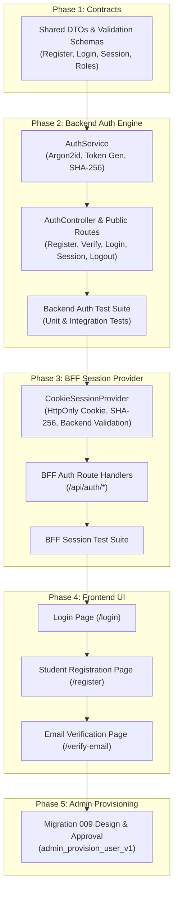

# Stage 2F.1 — Authentication Architecture and Existing-Code Audit

**Date:** 2026-11-26  
**Scope:** Stage 2F Authentication & Session Management Pre-Implementation Audit  
**Classification:** Internal Security Architecture Audit  
**Status:** Read-Only Audit Complete (No Source Changes Applied)

---

## Executive Summary

This comprehensive read-only audit reviews the existing authentication schema, contracts, BFF layer, backend services, and session infrastructure across the Parul University IPR Portal.

### Key Audit Conclusions:
1. **Migration 007 is fully sufficient for student registration and core authentication:** It provides tables and procedures for student pending registration, email verification, Argon2id credentials, failed-attempt account lockouts (5 attempts / 15-minute lockout), session creation (up to 30 days), session touch/validation, and session revocation.
2. **Migration 007 is NOT sufficient for administrative staff provisioning (Requirement 3):** There is currently no gateway function permitting an Administrator to provision Faculty, Reviewer, Legal, or Administrator accounts. A future migration (Migration 009) will be required for portal-based staff provisioning because `ipr_app` has zero direct `INSERT` privileges on `public.portal_users` and `auth_internal.user_credentials`.
3. **Critical Security Gap in Frontend BFF:** `packages/frontend/src/app/api/bff/[...path]/route.ts` is currently hardcoded to `MockTestSessionProvider`, which trusts `x-test-session-user` and `x-test-session-roles` headers. This mock must be replaced with a real cookie-based session provider before production deployment.
4. **Backend Authentication Layer is Missing:** While database functions exist in Migration 007, `packages/backend` has zero HTTP authentication routes (`/register`, `/verify-email`, `/login`, `/logout`, `/validate-session`).
5. **Cryptographic Separation:** The existing business HMAC assertion protocol (`OP_CREATE_DRAFT`, `OP_SUBMIT_DISCLOSURE`, etc.) is fully intact and must remain strictly isolated from public authentication endpoints.

---

## 1. Existing Authentication Architecture

### A. Monorepo Structural Separation
- **`packages/shared`**: Contains role definitions (`PORTAL_ROLES`, `SYSTEM_PRINCIPALS`), basic auth DTOs (`UserProfileDto`, `SessionData`, `RegisterUserDto`), and CSRF token generation/verification utilities (`generateCsrfToken`, `verifyCsrfToken`).
- **`packages/frontend` (Next.js 14 BFF)**:
  - Intercepts client requests via `/api/bff/[...path]`.
  - Whitelists business routes against `BFF_ROUTE_WHITELIST`.
  - Resolves session via `ISessionProvider`.
  - Performs CSRF verification on state-changing methods (`POST`, `PUT`, `PATCH`, `DELETE`).
  - Constructs 9-element canonical request strings and signs HMAC assertions (`X-BFF-*`) forwarded to the backend.
  - Currently lacks authentication route handlers (`/api/auth/*`) and frontend login/register UI pages.
- **`packages/backend` (Express API)**:
  - Mounts all existing routes under `protectedApiRouter` governed by `createBffAssertionMiddleware`.
  - Uses `pg.Pool` connected as `ipr_app`.
  - Holds `EmailService` configured with `nodemailer` for SMTP delivery.
  - Holds `"argon2": "^0.45.2"` dependency in `package.json`, but has no password hashing service or authentication controllers.

---

## 2. Existing Database Authentication Capabilities (Migration 007)

Migration `007_authentication.sql` defines complete database capabilities for student registration and session lifecycle:

### A. Relational Schema in `auth_internal`
1. **`auth_internal.user_credentials`**:
   - `user_id UUID PRIMARY KEY REFERENCES public.portal_users(id) ON DELETE RESTRICT`
   - `password_hash TEXT NOT NULL CHECK (password_hash LIKE '$argon2id$%')`
   - `failed_login_attempts INTEGER NOT NULL DEFAULT 0 CHECK (failed_login_attempts >= 0)`
   - `locked_until TIMESTAMPTZ`
   - `password_changed_at TIMESTAMPTZ NOT NULL DEFAULT clock_timestamp()`
2. **`auth_internal.pending_registrations`**:
   - `id UUID PRIMARY KEY DEFAULT public.gen_random_uuid()`
   - `email VARCHAR(255) NOT NULL` (enforces lowercase and domain `^[^@]+@paruluniversity[.]ac[.]in$`)
   - `full_name VARCHAR(255) NOT NULL`
   - `password_hash TEXT NOT NULL CHECK (password_hash LIKE '$argon2id$%')`
   - `verification_token_hash VARCHAR(128) NOT NULL UNIQUE` (stored as 64-char lowercase hex SHA-256)
   - `verification_expires_at TIMESTAMPTZ NOT NULL`
3. **`auth_internal.user_sessions`**:
   - `id UUID PRIMARY KEY DEFAULT public.gen_random_uuid()`
   - `user_id UUID NOT NULL REFERENCES public.portal_users(id) ON DELETE RESTRICT`
   - `session_token_hash VARCHAR(64) NOT NULL UNIQUE CHECK (session_token_hash ~ '^[a-f0-9]{64}$')`
   - `expires_at TIMESTAMPTZ NOT NULL CHECK (expires_at > created_at)`
   - `last_seen_at TIMESTAMPTZ NOT NULL DEFAULT clock_timestamp()`
   - `revoked_at TIMESTAMPTZ`

### B. Security Definer Stored Procedures (Granted to `ipr_app`)
1. **`auth_internal.create_pending_registration_v1(email, full_name, password_hash, token_hash, expires_at)`**:
   - Validates student email format `^[^@]+@paruluniversity[.]ac[.]in$`.
   - Checks that email does not already exist in `public.portal_users`.
   - Rejects expiry > 24 hours.
   - Inserts into `pending_registrations` and returns registration UUID.
2. **`auth_internal.verify_student_registration_v1(token_hash)`**:
   - Matches active, unexpired token hash with row lock (`FOR UPDATE`).
   - Inserts new record into `public.portal_users` with `roles = ARRAY['Student']::TEXT[]` and `status = 'ACTIVE'`.
   - Inserts credential into `auth_internal.user_credentials`.
   - Deletes pending registration atomically and returns the new `user_id`.
3. **`auth_internal.get_login_credentials_v1(email)`**:
   - Retrieves active account record: `user_id`, `email`, `full_name`, `roles`, `account_status`, `password_hash`, `failed_login_attempts`, `locked_until`.
4. **`auth_internal.record_login_attempt_v1(user_id, success)`**:
   - On success: resets `failed_login_attempts = 0` and `locked_until = NULL`.
   - On failure: increments `failed_login_attempts`. Upon reaching >= 5 failures, sets `locked_until = clock_timestamp() + INTERVAL '15 minutes'`.
5. **`auth_internal.create_user_session_v1(user_id, session_token_hash, expires_at)`**:
   - Verifies active user status; validates token hash regex and expiry (max 30 days).
   - Inserts into `user_sessions` and returns `session_id`.
6. **`auth_internal.validate_user_session_v1(session_token_hash)`**:
   - Touches `last_seen_at = clock_timestamp()`.
   - Validates unrevoked, unexpired session and `portal_users.status = 'ACTIVE'`.
   - Returns `session_id`, `user_id`, `email`, `full_name`, `roles`, `expires_at`.
7. **`auth_internal.revoke_user_session_v1(session_token_hash)`**:
   - Sets `revoked_at = clock_timestamp()` and returns boolean.

---

## 3. Missing Backend Functionality

The following components are missing from `packages/backend`:

1. **Public Authentication Router (`/api/v1/auth/*`):**
   - Current `app.ts` places all `/api/v1` routes under `protectedApiRouter`, which unconditionally rejects unauthenticated requests lacking HMAC assertions.
   - A public authentication router must be mounted outside `protectedApiRouter` for:
     - `POST /api/v1/auth/register` (student self-registration)
     - `POST /api/v1/auth/verify-email` (token verification and activation)
     - `POST /api/v1/auth/login` (credential verification and session creation)
     - `POST /api/v1/auth/validate-session` (session validation for BFF session provider)
     - `POST /api/v1/auth/logout` (session revocation)
2. **Argon2id Hashing & Password Verification Service:**
   - Backend needs an `AuthService` wrapping `argon2.hash()` and `argon2.verify()` using recommended Argon2id parameters (e.g. `type: argon2.argon2id`, memoryCost: 65536, timeCost: 3, parallelism: 4).
3. **Timing-Safe Login Verification:**
   - Missing dummy hash comparison to prevent user enumeration when a non-existent email is queried.
4. **Crypto Token Generation & Email Dispatch:**
   - Registration flow must generate a 256-bit cryptographically secure token, compute its SHA-256 hash for database storage, and dispatch an email with the raw token using `EmailService`.
5. **Rate Limiting:**
   - Missing endpoint-level rate limiting on `/register` and `/login` to mitigate credential stuffing and email flooding.

---

## 4. Missing Frontend Functionality

The following components are missing from `packages/frontend`:

1. **Production Session Provider (`CookieSessionProvider`):**
   - `MockTestSessionProvider` must be removed from production runtime.
   - Need a session provider that reads the session cookie from incoming browser requests, computes the SHA-256 hash, and verifies it with the backend session validation endpoint to yield a `BffSession`.
2. **Next.js Auth Route Handlers:**
   - `POST /api/auth/login`: forwards credentials to backend, sets `HttpOnly`, `Secure`, `SameSite=Strict`, `Path=/` session cookie, returns user profile + CSRF token.
   - `POST /api/auth/register`: forwards registration payload to backend.
   - `POST /api/auth/verify-email`: forwards verification token to backend.
   - `POST /api/auth/logout`: revokes session on backend and clears the session cookie.
   - `GET /api/auth/session` or `/api/auth/me`: returns authenticated user profile and fresh CSRF token for React state hydration.
3. **Frontend UI Pages:**
   - Login page (`/login`): email, password, error display, redirection to dashboard.
   - Student Registration page (`/register`): full name, `@paruluniversity.ac.in` email, password, confirmation, domain validation.
   - Email Verification page (`/verify-email`): token extraction from URL search params, activation status feedback.

---

## 5. Security Gaps and Potential Vulnerabilities

| Vulnerability / Risk | Location | Impact | Mitigation Required |
| :--- | :--- | :--- | :--- |
| **Mock Authentication in Production** | `frontend/.../route.ts` | High: Anyone can spoof identity via `x-test-session-user` header. | Replace `MockTestSessionProvider` with real `CookieSessionProvider`. Ensure mock headers are rejected outside test environments. |
| **User Enumeration via Timing** | Backend `/login` | Medium: Attackers can distinguish existing vs non-existing emails based on Argon2id computation duration. | Perform dummy Argon2id verification when email is not found in database. |
| **Account Lockout Brute-Force DoS** | Database / Backend | Medium: Attacker could lock out user accounts with 5 failed attempts. | Add IP-based rate limiting on `/login` to stop brute-force attacks before triggering account lockouts. |
| **Public Staff Registration Risk** | Business Layer | High: Unauthorized users might attempt to register as Faculty/Admin. | Strictly enforce that public registration only invokes `create_pending_registration_v1`, which hardcodes `ARRAY['Student']` in `verify_student_registration_v1`. |
| **SystemScanner Principal Misuse** | Role Management | High: `SystemScanner` could be used as human login identity. | Explicitly forbid `SystemScanner` from human login, registration, and session creation (`isPortalRole` check). |
| **Circular HMAC Dependency** | Gateway / BFF | High: Unauthenticated users cannot provide `X-BFF-Signature`. | Mount authentication routes independently from the business HMAC-assertion router. |
| **CSRF on State-Changing Auth** | BFF / Cookie | High: Cross-site request forgery on login/logout/registration. | Enforce `SameSite=Strict` on session cookies; require CSRF token validation on state-changing requests. |

---

## 6. Sufficiency of Database Migration 007 vs Future Migration 009

### A. What Migration 007 Fully Covers:
- Student self-registration with `@paruluniversity.ac.in` domain enforcement.
- Verification token hashing and 24-hour expiration.
- Atomic email verification and account activation into `portal_users` with `Student` role.
- Argon2id password hash storage and validation.
- Failed login attempt tracking and 15-minute lockout after 5 attempts.
- Opaque session token hashing (SHA-256), session expiration (up to 30 days), and session touch (`last_seen_at`).
- Session revocation on logout.

### B. What Migration 007 Does NOT Cover:
- **Administrative Provisioning of Staff Accounts (Requirement 3):**
  - Requirement 3 states: *"Faculty, Reviewer, Legal and Administrator accounts must be provisioned by an Administrator."*
  - Requirement 4 states: *"Public staff registration must not exist."*
  - `ipr_app` has `REVOKE ALL PRIVILEGES ON ALL TABLES` and **cannot** perform `INSERT INTO public.portal_users` or `INSERT INTO auth_internal.user_credentials`.
  - The only insertion procedure available to `ipr_app` is `verify_student_registration_v1`, which hardcodes `roles = ARRAY['Student']`.
- **Conclusion:**
  - **Migration 007 is fully sufficient for student self-registration, verification, login, session management, and logout.**
  - **A future migration (Migration 009) will be required to introduce an administrator-only gateway routine** (e.g. `public.admin_provision_user_v1(p_assertion JSONB, p_email VARCHAR, p_full_name VARCHAR, p_roles TEXT[], p_password_hash TEXT)`) to allow an authenticated Administrator to provision non-student accounts.
  - *No migration will be written or executed without explicit user approval.*

---

## 7. Recommended Implementation Sequence

---

## 8. Exact Files Identified for Modification / Creation

### A. Shared Package (`packages/shared`)
- **[disclosure.dto.ts](file:///d:/GitHub/IPR-Parul%20University/packages/shared/src/dtos/disclosure.dto.ts)** / **`auth.dto.ts`**: Add `StudentRegisterDto`, `VerifyEmailDto`, `LoginDto`, `AuthUserDto`, `ValidateSessionResponseDto`, and Zod schemas.
- **`packages/shared/src/index.ts`**: Export new DTOs and validation schemas.

### B. Backend Package (`packages/backend`)
- **`packages/backend/src/services/auth.service.ts`** *(New)*: Core authentication logic, Argon2id hashing/verification, crypto random generation, timing-attack protection, database function execution.
- **`packages/backend/src/controllers/auth.controller.ts`** *(New)*: Request handlers mapping database outcomes to RFC 7807 problem details.
- **`packages/backend/src/routes/auth.routes.ts`** *(New)*: Router defining `/register`, `/verify-email`, `/login`, `/validate-session`, `/logout`.
- **[app.ts](file:///d:/GitHub/IPR-Parul%20University/packages/backend/src/app.ts)**: Mount `authRouter` under `/api/v1/auth` outside `protectedApiRouter`.
- **`packages/backend/tests/auth.spec.ts`** *(New)*: Comprehensive unit tests covering registration, token verification, login, lockout, session validation, and logout.

### C. Frontend Package (`packages/frontend`)
- **`packages/frontend/src/server/session/cookie-session-provider.ts`** *(New)*: Production `ISessionProvider` reading cookies and validating sessions with the backend.
- **[route.ts](file:///d:/GitHub/IPR-Parul%20University/packages/frontend/src/app/api/bff/%5B...path%5D/route.ts)**: Replace `MockTestSessionProvider` with `CookieSessionProvider`.
- **`packages/frontend/src/app/api/auth/[...path]/route.ts`** *(New)*: Route handlers managing `ipr_session` cookies and CSRF synchronizer tokens.
- **`packages/frontend/src/app/(auth)/login/page.tsx`** *(New)*: Login UI page.
- **`packages/frontend/src/app/(auth)/register/page.tsx`** *(New)*: Student self-registration UI page.
- **`packages/frontend/src/app/(auth)/verify-email/page.tsx`** *(New)*: Email verification UI page.

---

## 9. Verification & Stop Compliance

- No migrations `001`–`008` were modified.
- No new migrations were created.
- No SQL was executed against PostgreSQL.
- No source code files were edited during this audit.
- Verification status remains clean across the monorepo.

---

## 10. Stage 2F.2B — Proxy & Rate-Limiter Hardening Architecture Notice

### A. Express Trust Proxy Configuration
1. **Explicit, Environment-Driven Proxy Trust:**
   - Express `trust proxy` is configured via `TRUST_PROXY` in `BackendEnvSchema` (defaulting to `'false'`).
   - In production mode, blind `TRUST_PROXY="true"` is strictly prohibited to prevent client IP spoofing.
   - Operators must configure explicit trusted reverse-proxy subnets (e.g. `'loopback'`, `'10.0.0.0/8'`, or specific upstream IP lists).
   - In local development (`TRUST_PROXY=false`), Express derives `req.ip` directly from `req.socket.remoteAddress`, completely ignoring client-supplied `X-Forwarded-*` headers.

### B. In-Memory Rate Limiting Architecture & Production Limitation
1. **Synchronous Count Tracking:**
   - Counter increments occur synchronously within the Node.js event loop before any asynchronous I/O, preventing concurrency race conditions within a single backend process.
2. **Periodic Stale Entry Eviction:**
   - Expired window entries are evicted on request lookup and via a periodic unref'd timer interval (`Math.min(windowMs, 60000)`), preventing unbounded memory growth.
3. **Route Independence:**
   - Separate instances of `createRateLimiter` govern `/api/v1/auth/register` and `/api/v1/auth/verify-email`. Exhausting registration rate limits does not affect email verification from the same client IP.
4. **Production Multi-Instance Limitation:**
   - **Crucial Architectural Note:** The in-memory rate limiter maintains request count state in a process-local JavaScript `Map`. When scaling the backend horizontally across multiple processes, containers, or pods, request counts are **not** shared across instances.
   - For multi-instance production clustering, the rate limiter must be migrated to a distributed backplane (such as Redis or Memcached). In single-process deployments and development, the current in-memory solution provides zero-dependency, reliable protection against automated brute-force attacks.

